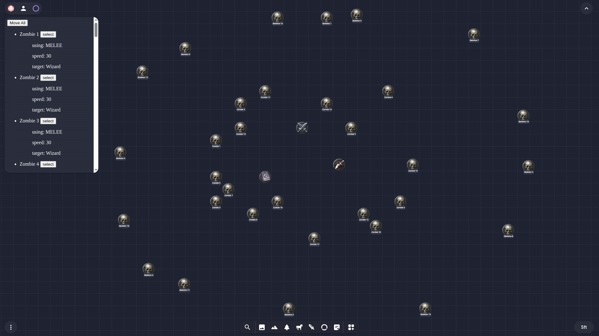
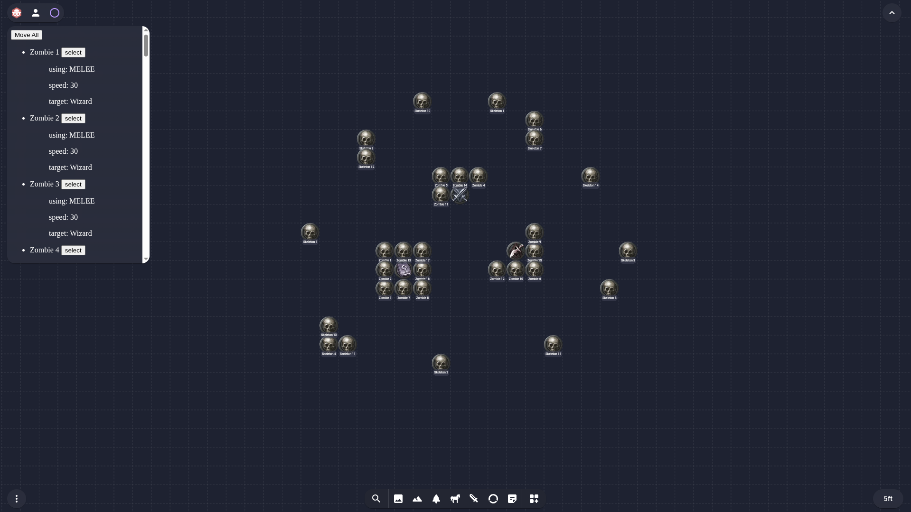

# Owlbear NPC Automation

This is an extension for Owlbear Rodeo that allows you to automatically move
tokens (NPCs) toward other tokens, if there is a path. This is useful in combat
when you have many simple creatures and don't want to move each individually.

# Installation

Add a custom extension to Owlbear, and use
**https://bonewheelmaster.github.io/Owlbear-NPC-Automation/manifest.json** as the link.

Ensure the extension is enabled in the current scene.

# Usage

There are two ways of interacting with this extension: the panel and the context menu.

## The Panel

Provides a list of all NPCs and their values, a way to select them,
and a "move all" button. This will be on the edge of your screen somewhere,
the icon is

## The Context Menu

To enable or change the settings of an NPC/s, select it/them and right click. There
will be an enable NPC button, and afterwards will be a menu where you can change its
settings, move it or disable it.

To set an NPC's target, find the ID of the target (right click and press show ID).
An example of an ID is `3d93594f-0f25-4b11-916f-f50badc68cb5`.

There are currently two strategies available: melee and ranged. Melee attempts to
get as close as possible to the target; ranged will stop moving when within
the specified range.

# Performance

The efficient A* algorithm is used. However, performance can still be an issue
with extremely far away NPCs or large quantities of them. To mitigate this, each
NPC will only look for a path for up to half a second. To improve performance,
disable NPCs that are too far away.

# TODO

- Hex grids (mostly work, but there are a few bugs)
- Dimetric/Isometric grids
- Collision with larger tokens (each token is currently treated as taking one square/hex)
- Collision with map, perhaps via walls from other extensions (can't use the image of the map)
- Allow other grid scales (all grids are currently treated as being 5ft per square/hex)
